# Order Manager: CI/CD, observabilidad y entornos reales con DevOps

Evaluación Parcial N°2 y N°3, **DOY0101 Ingeniería DevOps**, sección 002.

**Autor:** Alan Maximiliano Burgos Sepúlveda (trabajo individual).

API REST para gestionar pedidos de un e-commerce. En la **EP2** se automatizó su ciclo de vida (pruebas, seguridad, imagen Docker y despliegue simulado). En la **EP3** se extendió con observabilidad (Prometheus, Loki, Grafana), despliegue real en Kubernetes sobre Amazon EKS, métricas del propio pipeline, políticas de cumplimiento y bloqueos automáticos.

---

## Índice

1. [Resumen y arquitectura](#1-resumen-y-arquitectura)
2. [El microservicio](#2-el-microservicio)
3. [Contenedores (base EP2)](#3-contenedores-base-ep2)
4. [Orquestación con Docker Compose (base EP2)](#4-orquestación-con-docker-compose-base-ep2)
5. [Calidad (base EP2)](#5-calidad-base-ep2)
6. [Seguridad (base EP2)](#6-seguridad-base-ep2)
7. [Trazabilidad (base EP2)](#7-trazabilidad-base-ep2)
8. [Deudas de la EP2 resueltas](#8-deudas-de-la-ep2-resueltas)
9. [Monitoreo local (IE1)](#9-monitoreo-local-métricas-y-logs-ie1)
10. [Kubernetes en AWS (IE2)](#10-despliegue-en-kubernetes-sobre-aws-ie2)
11. [Dashboard CI/CD (IE3)](#11-dashboard-integrado-al-cicd-ie3)
12. [Integración y decisiones (IE4)](#12-integración-de-herramientas-y-apoyo-a-decisiones-ie4)
13. [Cumplimiento (IE5)](#13-políticas-de-cumplimiento-ie5)
14. [Bloqueos automáticos (IE6)](#14-bloqueos-automáticos-demostrados-ie6)
15. [Limitaciones conocidas](#15-limitaciones-conocidas)
16. [Cómo ejecutarlo](#16-cómo-ejecutarlo)
17. [Secretos y variables](#17-secretos-y-variables-necesarios)
18. [Declaración de uso de IA](#18-declaración-de-uso-de-inteligencia-artificial)
19. [Conclusiones](#19-conclusiones)
20. [Reflexión personal](#20-reflexión-personal)

---

## 1. Resumen y arquitectura

| Elemento | Detalle |
|---|---|
| Aplicación | Java 17, Spring Boot 4.0.10, Maven, puerto 8098 |
| Persistencia | PostgreSQL 16 (H2 en desarrollo y pruebas) |
| Métricas | Spring Boot Actuator + Micrometer, endpoint `/actuator/prometheus` |
| Monitoreo | Prometheus 3.5, Grafana 12.2, Loki 3.5, Grafana Alloy 1.10, Pushgateway 1.11 |
| Orquestación | Docker Compose (local y *staging* simulado) y Kubernetes en Amazon EKS |
| CI/CD | GitHub Actions, imagen en GitHub Container Registry etiquetada con el SHA del commit |

### Pipeline

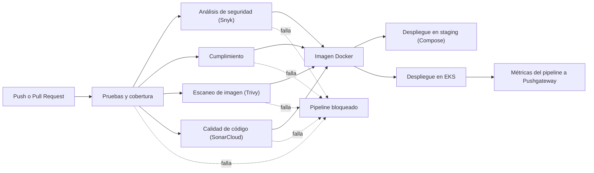

Cada job depende de los anteriores mediante `needs`. Si cualquiera de los cinco controles falla, **no se construye la imagen ni se despliega nada**. Los despliegues solo ocurren en un `push` a `main`; en un Pull Request se ejecutan los controles pero no se publica ni despliega.

### Arquitectura en el clúster

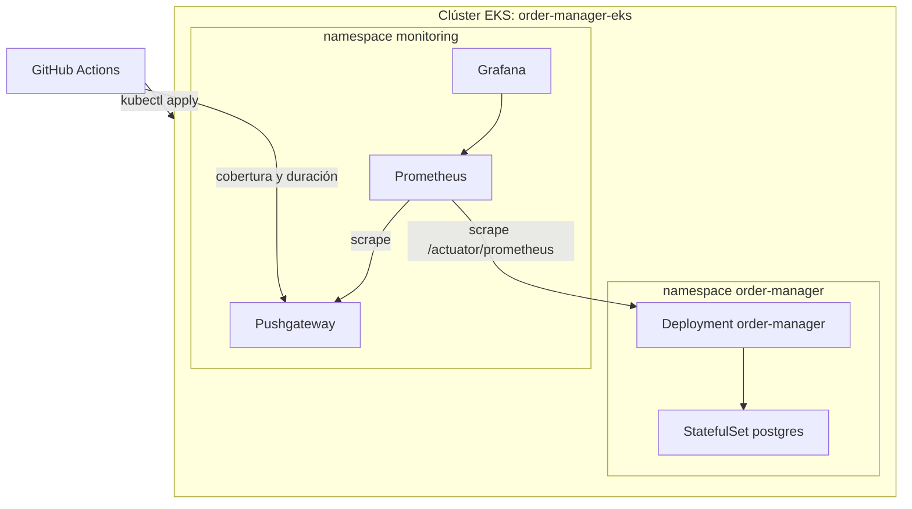

---

## 2. El microservicio

| Elemento | Detalle |
|---|---|
| Lenguaje y framework | Java 17, Spring Boot 4.0.10, Maven |
| Persistencia | Spring Data JPA. H2 en memoria para desarrollo y pruebas, PostgreSQL 16 dentro de Docker |
| Monitoreo | Spring Boot Actuator (`/actuator/health`) y Micrometer (`/actuator/prometheus`) |
| Puerto | 8098 |

Endpoints principales (`/api/orders`):

| Método | Ruta | Acción |
|---|---|---|
| GET | `/api/orders` | Listar pedidos |
| GET | `/api/orders/{id}` | Obtener un pedido |
| GET | `/api/orders/status/{status}` | Filtrar por estado |
| POST | `/api/orders` | Crear un pedido |
| POST | `/api/orders/{id}/items` | Agregar un ítem |
| PUT | `/api/orders/{id}/confirm`, `/ship`, `/deliver`, `/cancel` | Cambiar el estado |
| DELETE | `/api/orders/{id}` | Eliminar un pedido |

---

## 3. Contenedores (base EP2)

El `Dockerfile` usa **dos etapas**:

1. **Compilación:** imagen `maven:3.9-eclipse-temurin-17`. Copia primero el `pom.xml` para aprovechar la caché de dependencias y luego el código.
2. **Ejecución:** imagen `eclipse-temurin:17-jre-alpine`, liviana y solo con el JRE y el `.jar`.

Configuraciones adicionales: la aplicación corre con un usuario **no root**, define un `HEALTHCHECK` sobre Actuator y el `.dockerignore` excluye `target/`, `.git/` y documentación.

---

## 4. Orquestación con Docker Compose (base EP2)

`docker-compose.yml` define dos servicios:

- **`db`** (PostgreSQL 16): con volumen persistente `db_data`, `healthcheck` con `pg_isready` y **sin puertos publicados** hacia el exterior.
- **`app`**: espera a que la base esté `healthy` (`depends_on` con `service_healthy`), usa el perfil `docker`, tiene límites de CPU (0,5) y memoria (512 MB) y reinicio automático.

Ambos comparten una red privada `backend`. Las credenciales llegan por variables de entorno (archivo `.env`, que no se versiona). El perfil `docker` (`application-docker.properties`) cambia la base a PostgreSQL, desactiva la consola H2 y oculta los detalles internos del `health`.

| Servicios levantados | Salud de la aplicación |
|---|---|
| 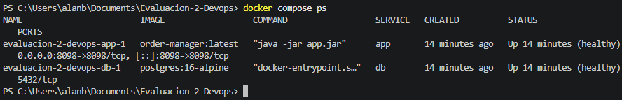 | 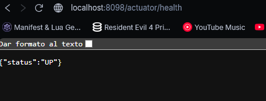 |

**Persistencia de datos:** se creó un pedido, se ejecutó `docker compose down` y `up -d`, y el pedido seguía disponible.

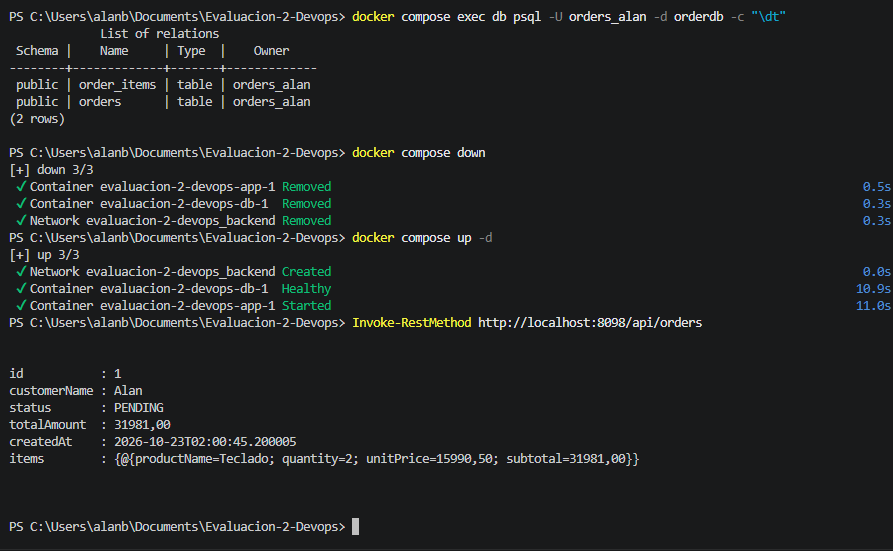

---

## 5. Calidad (base EP2)

- **Pruebas:** 35 pruebas unitarias y de integración (24 en la EP2 y 11 agregadas en la EP3), con JUnit 5, Mockito y MockMvc, sobre servicio y controlador.
- **Política de calidad:** cobertura mínima de **70 % de líneas**, verificada por JaCoCo en la fase `verify`. Si la cobertura baja de ese valor, `mvn verify` falla y el pipeline se detiene.
- **Evidencia del bloqueo:** se probó temporalmente con un umbral de 95 %, y el build falló como se esperaba. Luego se restauró el 70 %.

| Reporte de cobertura | Bloqueo por cobertura insuficiente |
|---|---|
| 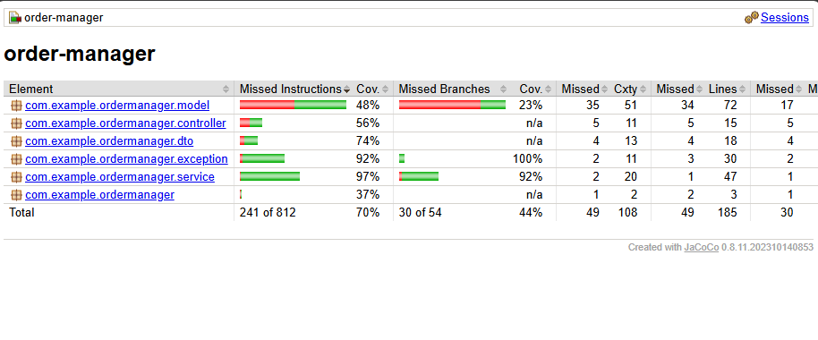 | 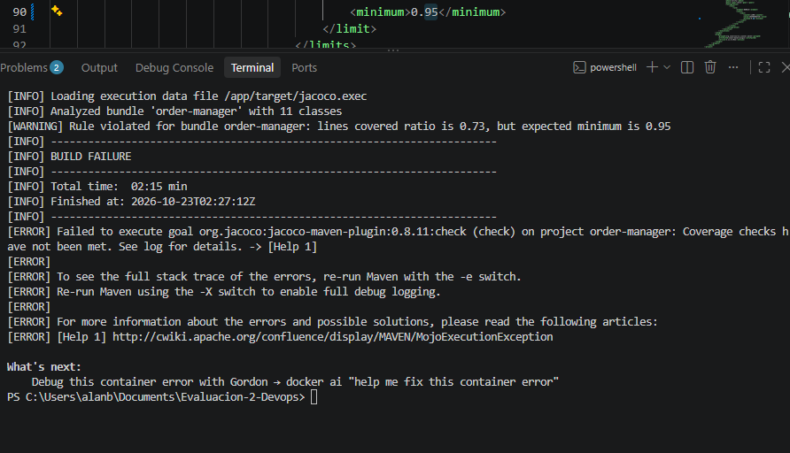 |

---

## 6. Seguridad (base EP2)

**Análisis de seguridad.** Snyk escanea las dependencias con `--severity-threshold=high`. Si encuentra vulnerabilidades altas o críticas, el job falla, el pipeline emite una anotación de error (`::error`) y no se construye ni se despliega nada.

**Historial real de las vulnerabilidades encontradas:**

| Versión | Problemas encontrados por Snyk |
|---|---|
| Spring Boot 3.3.4 | 69 |
| Spring Boot 3.5.16 | 25 |
| Spring Boot 4.0.8 | 13 |
| Spring Boot 4.0.9 y driver PostgreSQL 42.7.14 | Solo queda 1, sin corrección disponible (ver abajo) |

En la EP3 apareció una vulnerabilidad crítica nueva en `jackson-databind 3.1.7`; se corrigió subiendo a Spring Boot 4.0.10. Antes, la migración a Spring Boot 4.0.9 corrigió los problemas de Tomcat y Jackson. Esto implicó ajustes menores: el starter `spring-boot-starter-webmvc`, el starter de pruebas `spring-boot-starter-webmvc-test` y el reemplazo de `@MockBean` por `@MockitoBean` en el test del controlador.

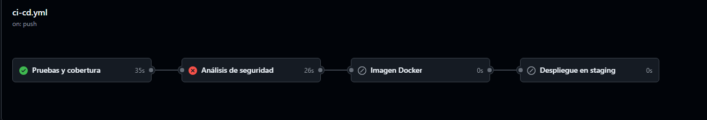

**Excepción documentada.** Queda una vulnerabilidad (`SNYK-JAVA-ORGGLASSFISHJAXB-20883142`, XXE en `jaxb-core`, que llega a través de Hibernate) para la cual Snyk indica que no existe actualización ni parche. Se registró en el archivo `.snyk` con vencimiento el 31 de diciembre de 2026, para obligar a revisarla. Justificación del equipo:

> Problema de XML External Entity (XXE) Injection, es una vulnerabilidad de alto riesgo que permite a un atacante interferir en cómo una aplicación procesa datos XML, lo que hace es agregar una línea DOCTYPE foo para acceder de manera remota, sin embargo, mi aplicación trabaja con JSON no con XML por lo que se acepta temporalmente el riesgo.

**Dependabot.** `.github/dependabot.yml` vigila semanalmente tres ecosistemas: Maven, Docker y GitHub Actions. Abre Pull Requests automáticos cuando hay versiones nuevas o vulnerabilidades.

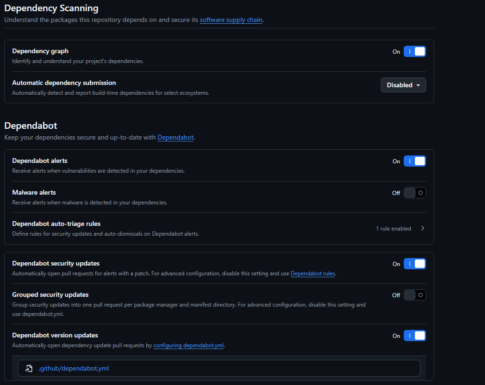

**Protección de la rama `main`.** Un ruleset exige Pull Request y que pasen los checks antes de fusionar (en la EP3 se ampliaron de 2 a 5, ver sección 13). Así no puede entrar a `main` código que no cumpla la política de calidad y seguridad.

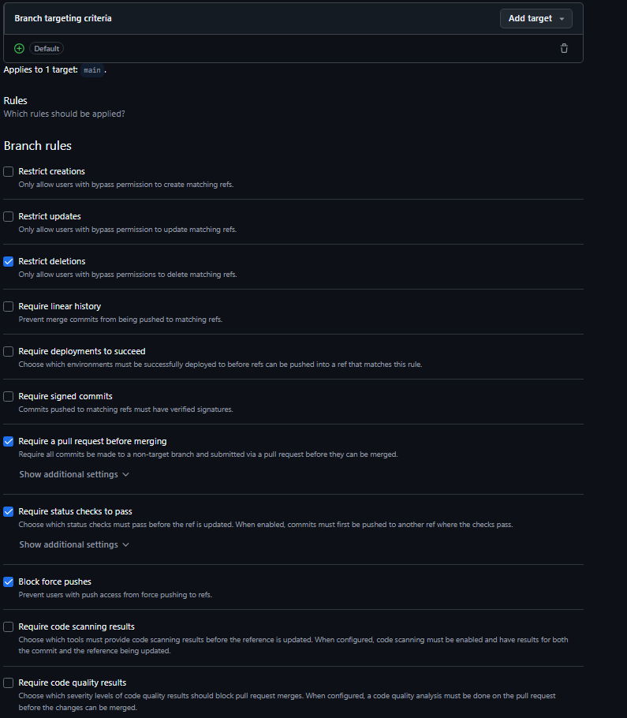

**Otras medidas:** credenciales en *secrets* de GitHub y nunca en el código, contenedor sin privilegios de root, base de datos sin puertos expuestos, límites de CPU y memoria, y reinicio automático de los servicios.

---

## 7. Trazabilidad (base EP2)

Se puede seguir un cambio desde el desarrollo hasta el despliegue:

1. **Commit y Pull Request:** cada cambio queda registrado en el historial, con su rama y revisión.
2. **Ejecución del pipeline:** GitHub Actions asocia cada ejecución a un commit concreto.
3. **Imagen:** se publica en GHCR etiquetada con el **SHA completo del commit**, de modo que cada imagen se vincula con el código exacto que la generó.
4. **Despliegue:** el job usa esa misma imagen, la registra en el *Environment* `staging` y deja un resumen con commit, autor, imagen y número de ejecución.

| Imagen publicada | Entorno staging |
|---|---|
| 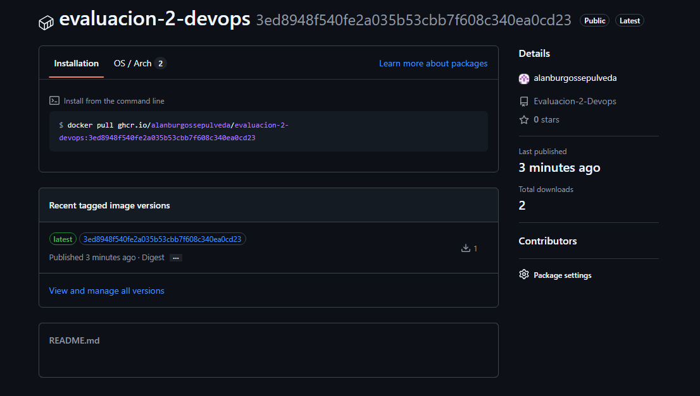 | 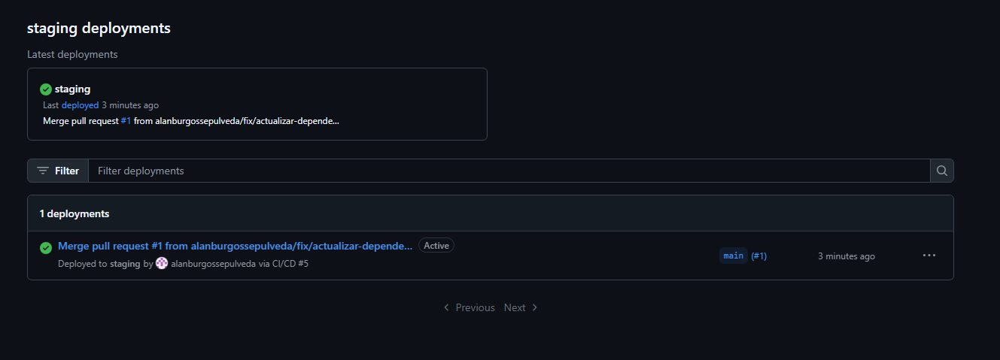 |

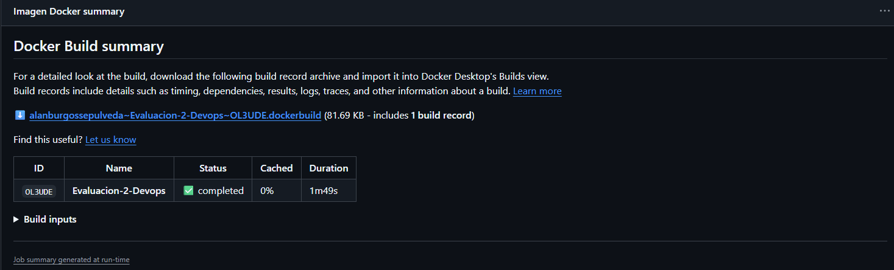

---

## 8. Deudas de la EP2 resueltas

Antes de extender el proyecto se corrigieron tres puntos pendientes de la evaluación anterior:

- **Más pruebas del controlador:** se agregaron 11 pruebas (transiciones de estado, errores 404 y 409, validaciones). El total pasó a **35 pruebas** (19 de controlador y 16 de servicio) y la cobertura de líneas ronda el **76 %**, por encima del umbral de 70 %.
- **Vulnerabilidad crítica nueva:** Snyk detectó una deserialización insegura en `jackson-databind 3.1.7`, publicada después de la entrega anterior. El pipeline se detuvo y se corrigió subiendo Spring Boot de 4.0.9 a **4.0.10**.
- **Excepción documentada:** se mantiene la excepción de `jaxb-core` en el archivo `.snyk`, con motivo y fecha de vencimiento (31 de diciembre de 2026).

---

## 9. Monitoreo local: métricas y logs (IE1)

### Métricas

La aplicación expone métricas en formato Prometheus gracias a la dependencia `micrometer-registry-prometheus` y a la propiedad `management.endpoints.web.exposure.include=health,info,prometheus`. Todas llevan la etiqueta `application="order-manager"`.

`docker-compose.monitoring.yml` agrega Prometheus (lee las métricas cada 15 segundos), Grafana (con Prometheus y Loki ya configurados como fuentes de datos) y los servicios de logs.

| Métricas expuestas por la aplicación | Targets en Prometheus |
|---|---|
| 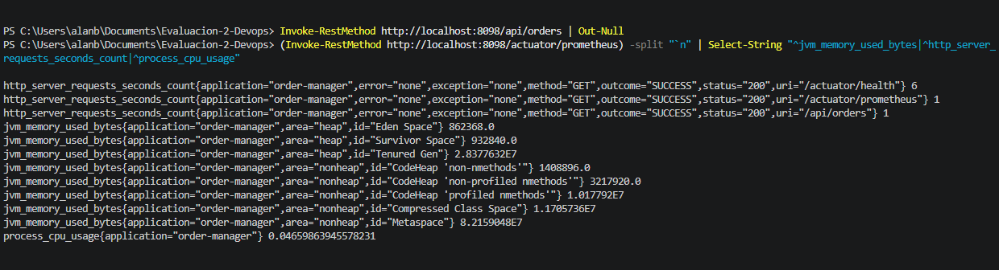 | 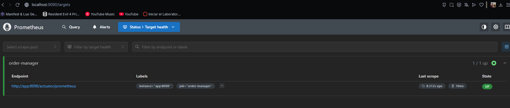 |

| Consulta en Prometheus | Datasource en Grafana |
|---|---|
| 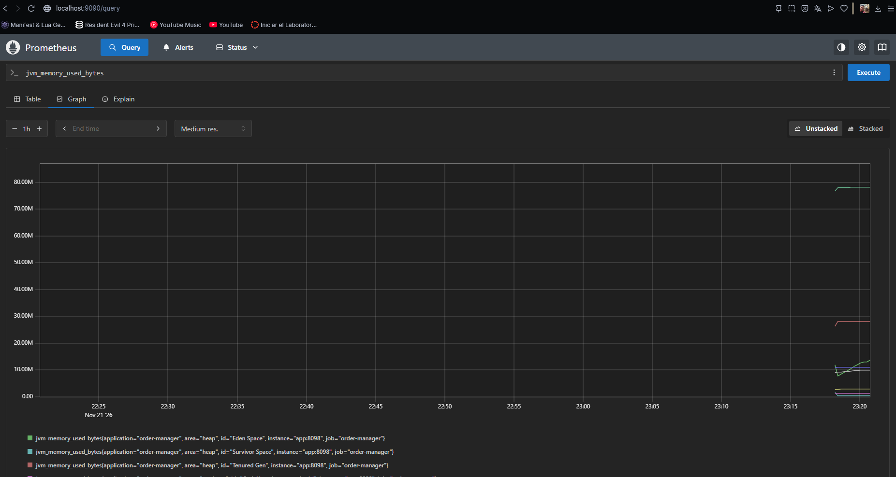 | 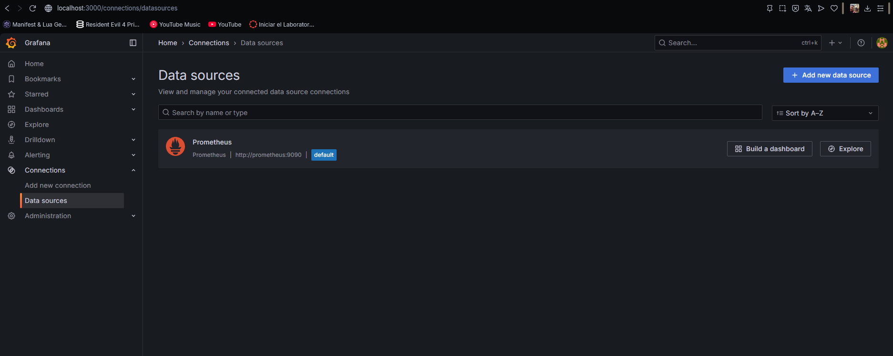 |

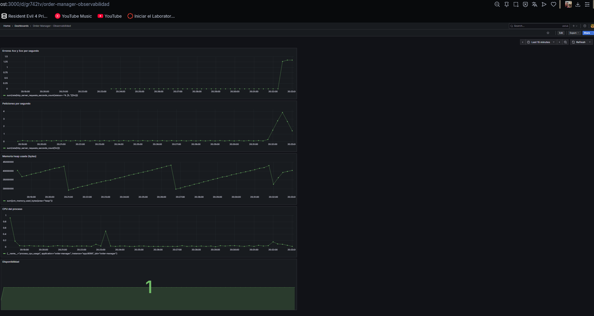

El dashboard local cubre cuatro dimensiones: **disponibilidad** (`up`), **uso de recursos** (CPU y memoria heap de la JVM), **tráfico** (peticiones por segundo) y **errores** (respuestas 4xx y 5xx por segundo).

### Logs

**Grafana Alloy** lee los logs de todos los contenedores a través del socket de Docker, los etiqueta con `container` y `service`, y los envía a **Loki**. En Grafana se consultan, por ejemplo, con `{service="app"}` o `{service="app"} |= "ERROR"`.

| Logs en Explore | Logs en el dashboard |
|---|---|
| 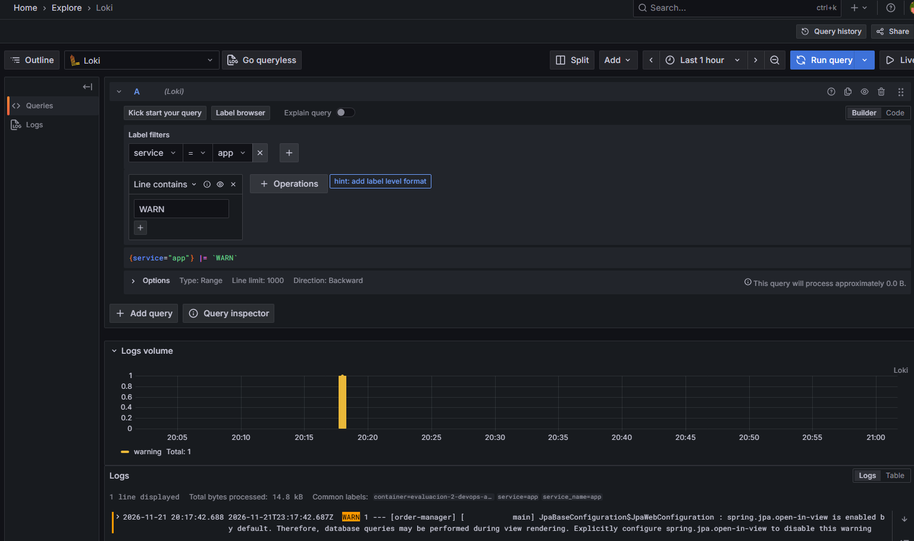 | 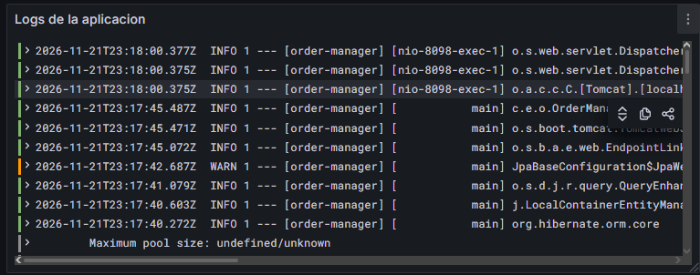 |

---

## 10. Despliegue en Kubernetes sobre AWS (IE2)

### Manifiestos (`k8s/`)

| Archivo | Contenido |
|---|---|
| `namespace.yaml` | Namespace `order-manager` |
| `app.yaml` | `Deployment` de la aplicación y `Service`. Una réplica, actualización progresiva sin caída (`maxUnavailable: 0`), sondas `startup`, `readiness` y `liveness`, y límites de CPU (500 m) y memoria (512 Mi) |
| `postgres.yaml` | `StatefulSet` de PostgreSQL con volumen persistente de 1 Gi (versión local) |
| `postgres-aws.yaml` | Igual, pero con volumen temporal (`emptyDir`); ver [limitaciones](#15-limitaciones-conocidas) |
| `monitoring/` | Prometheus, Grafana y Pushgateway en el namespace `monitoring` |

Las credenciales no están en los manifiestos: se crean como `Secret` de Kubernetes directamente en el clúster (`db-credentials` y `grafana-admin`).

Primero se probó todo en el Kubernetes de Docker Desktop:

| Pods locales | API dentro del clúster |
|---|---|
| 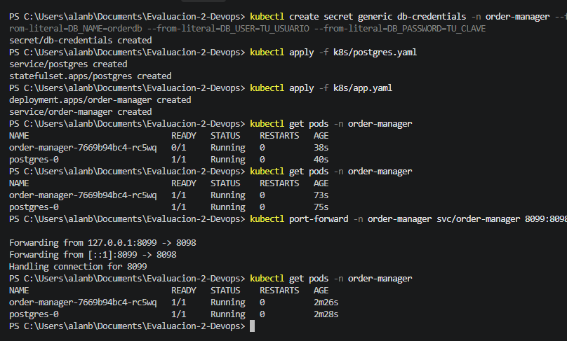 | 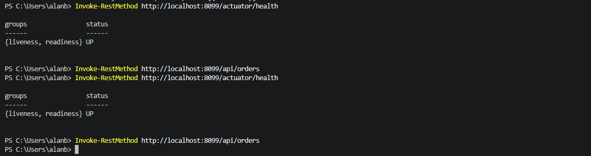 |

### Clúster en AWS

Se usó **Amazon EKS** dentro de AWS Academy Learner Lab (región `us-east-1`): clúster `order-manager-eks` con un grupo de nodos `ng-principal` de **dos nodos `t3.medium`**, usando el rol `LabRole`.

| Clúster activo | Grupo de nodos | Nodos |
|---|---|---|
| 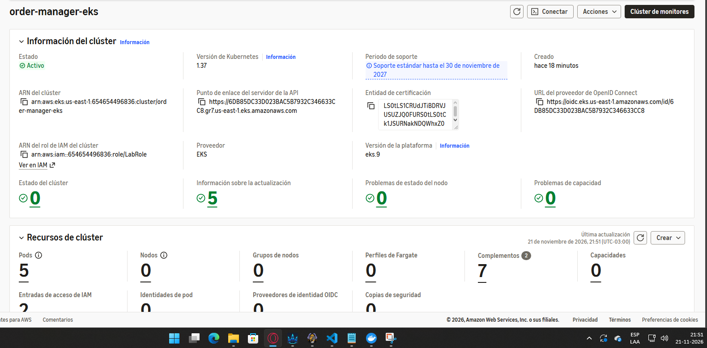 | 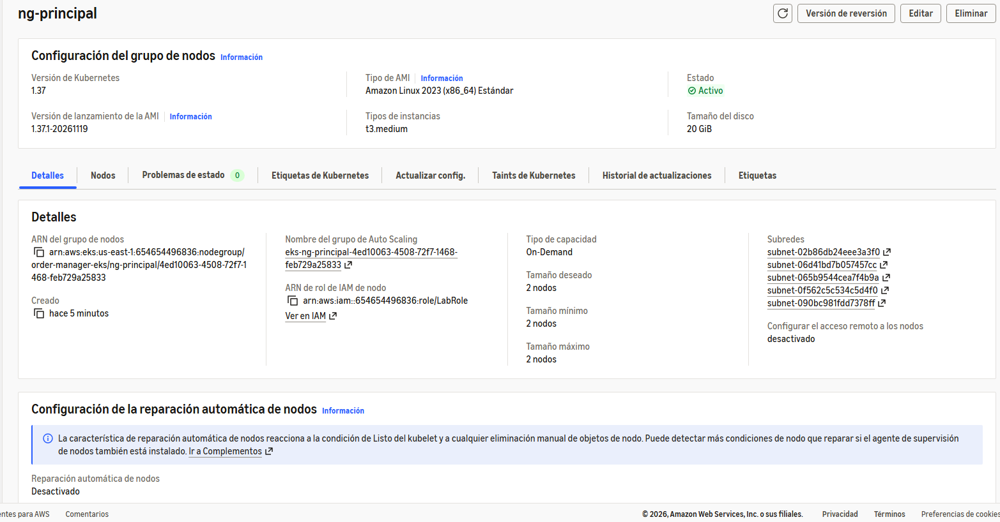 | 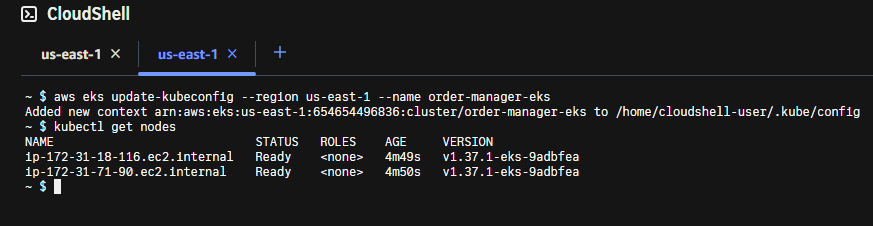 |

| Pods en EKS | API respondiendo en el clúster |
|---|---|
| 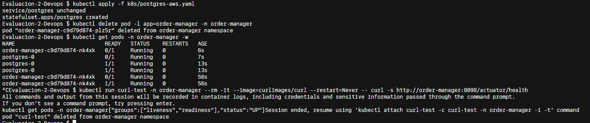 | 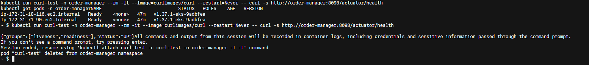 |

### Despliegue automático desde el pipeline

El job **Despliegue en EKS** de `.github/workflows/ci-cd.yml`, tras construir la imagen:

1. Obtiene las credenciales temporales de AWS desde los *secrets* del repositorio.
2. Se conecta al clúster con `aws eks update-kubeconfig`.
3. Aplica los manifiestos, reemplazando la imagen por la del **commit exacto** (`ghcr.io/<repositorio>:<SHA>`).
4. Espera a que cada despliegue termine (`kubectl rollout status`).
5. Registra un resumen en la página de la ejecución.

El *environment* `eks` de GitHub limita el despliegue a la rama `main`. Un interruptor (la variable `EKS_ENABLED`) permite apagar el job cuando el clúster no existe.

| Ejecución completa | Resumen del despliegue |
|---|---|
| 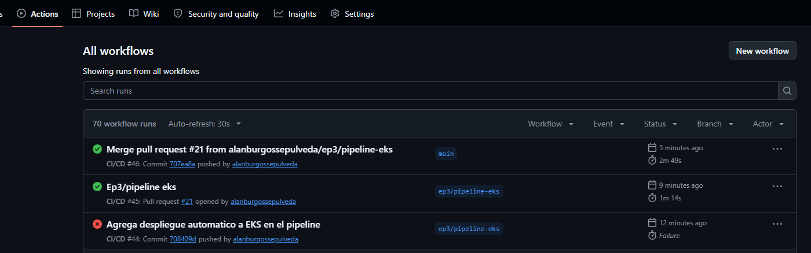 | 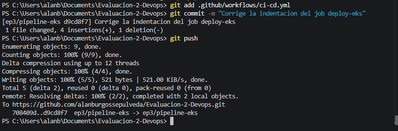 |

| Environment `eks` | Regla: solo desde `main` |
|---|---|
| 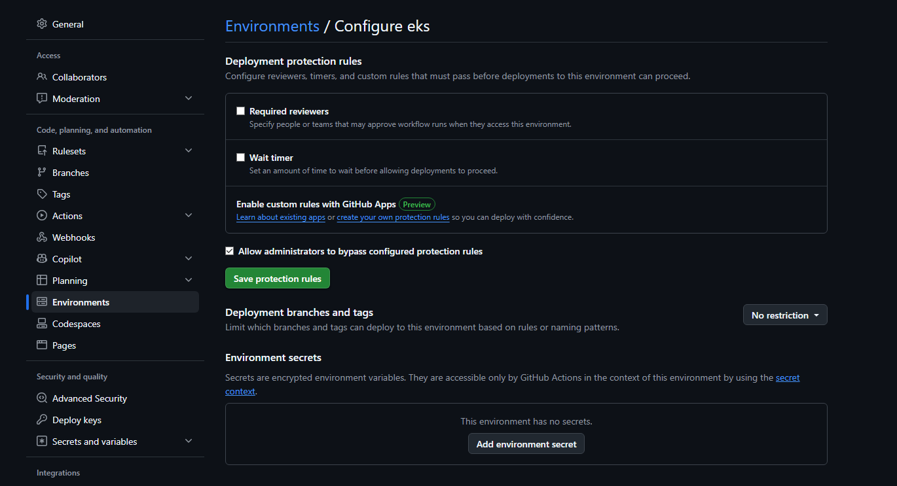 | 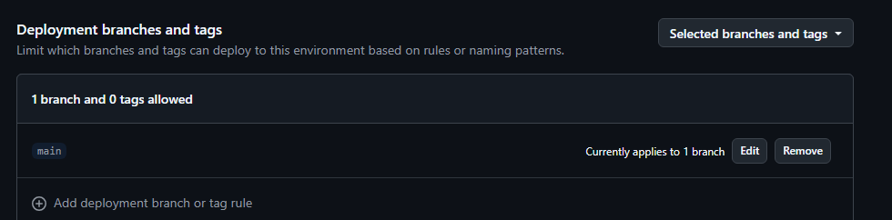 |

### Monitoreo dentro del clúster

Prometheus corre en el namespace `monitoring` y **descubre solo los pods** de la aplicación leyendo la API de Kubernetes: busca los pods con la anotación `prometheus.io/scrape: "true"`. Grafana se expone con un `Service` de tipo `LoadBalancer`. Todo se aplica desde el pipeline, sin pasos manuales (salvo la creación inicial de los secretos).

| Prometheus ve el pod | Grafana en el clúster |
|---|---|
| 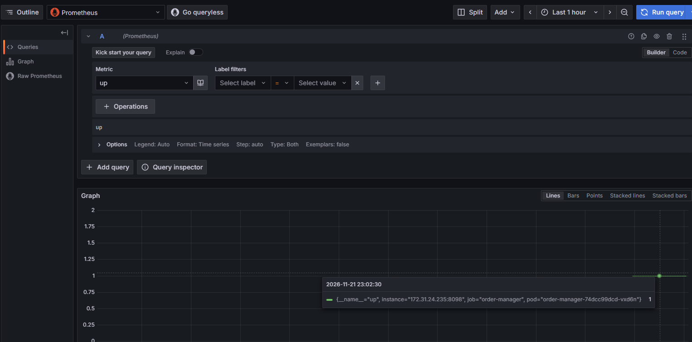 | 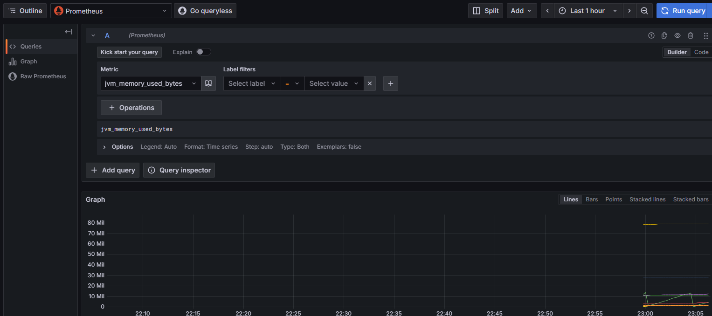 |

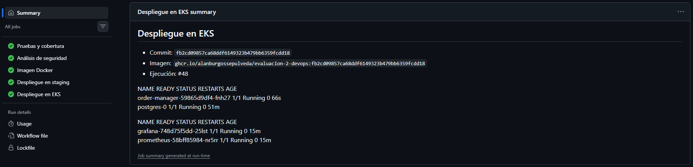

---

## 11. Dashboard integrado al CI/CD (IE3)

Para que el dashboard muestre información del **pipeline** y no solo de la aplicación, el job de despliegue publica métricas en un **Pushgateway** (un buzón dentro del clúster que Prometheus consulta):

| Métrica | Cómo se obtiene |
|---|---|
| `ci_test_coverage_percent` | El job de pruebas calcula la cobertura de líneas a partir de `jacoco.csv` y la pasa al despliegue como salida |
| `ci_deploy_duration_seconds` | Diferencia de tiempo entre el inicio del job de despliegue y su final |
| `ci_deploy_success` | 1 si el despliegue terminó bien, 0 si falló |
| `ci_deploy_timestamp_seconds` | Momento del despliegue |

El dashboard **Order Manager - CI/CD** tiene seis paneles: cobertura de pruebas, duración del último despliegue, último despliegue exitoso, CPU, memoria heap y errores 4xx/5xx por segundo. Está exportado en `monitoring/dashboards/order-manager-cicd.json`.

| Cobertura calculada en el pipeline | Métricas publicadas |
|---|---|
| 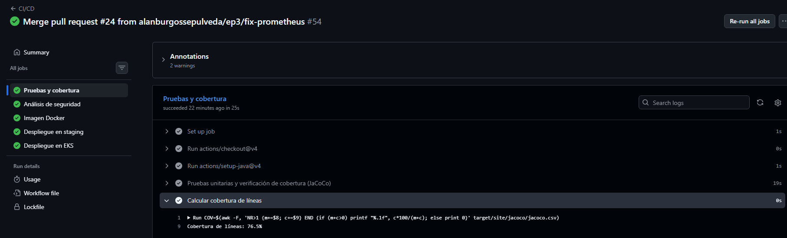 | 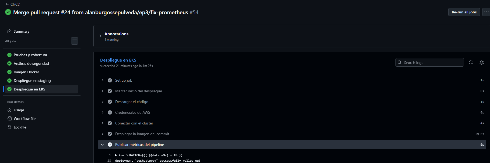 |

| Métrica del CI/CD en Prometheus | Dashboard completo |
|---|---|
| 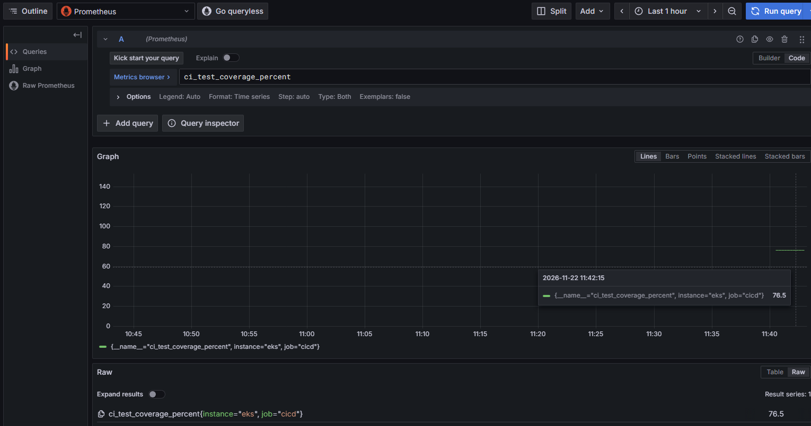 | 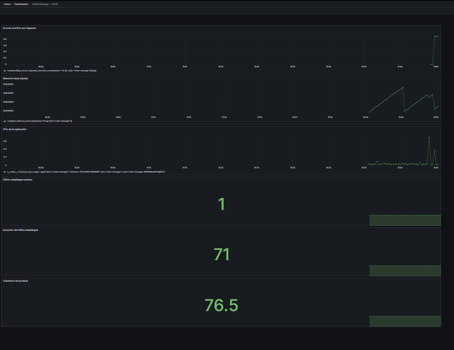 |

Un despliegue fallido también deja su rastro: el paso de métricas se ejecuta siempre y registra `ci_deploy_success 0`.

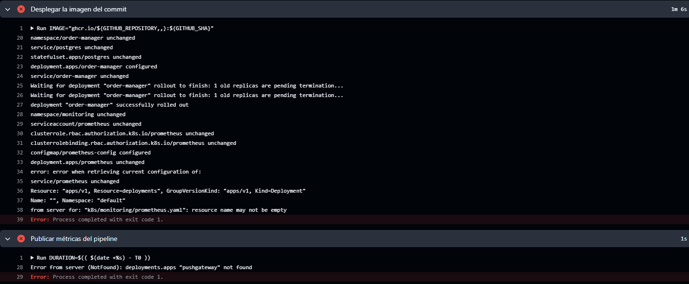

---

## 12. Integración de herramientas y apoyo a decisiones (IE4)

### Cómo se conectan las herramientas

| Herramienta | Qué aporta | Se conecta con |
|---|---|---|
| Micrometer + Actuator | Mide la aplicación | Prometheus (lectura cada 15 s) |
| Prometheus | Almacena métricas | Grafana (consultas) |
| Loki + Alloy | Centralizan los logs de los contenedores | Grafana |
| Pushgateway | Recibe las métricas del pipeline | Prometheus |
| Grafana | Visualiza métricas y logs | Prometheus y Loki |
| GitHub Actions | Ejecuta controles y despliega | Todas las anteriores, vía `kubectl` |

### De la métrica a la decisión

| Señal | Dónde se ve | Decisión que permite |
|---|---|---|
| Disponibilidad (`up`) | Dashboard | El 1 indica que el servicio está UP; si pasa a 0 hay que revisar el estado del pod o del clúster |
| CPU y memoria | Dashboard | Permite saber el uso de los componentes y en caso de acercarse al límite estos se suben |
| Errores 4xx/5xx | Dashboard y logs | Si hay error 5xx se revisan los logs; si es 4xx se revisan las validaciones |
| Cobertura de pruebas | Dashboard (desde el pipeline) | Si bajan del umbral, se exigen más pruebas antes de aceptar cambios |
| Duración del despliegue | Dashboard (desde el pipeline) | Si se detecta un aumento anómalo, se revisan los tiempos de descarga o la red del clúster |

### Umbrales y criterio de reversión

El pipeline me puede decir qué pasó o qué falló, pero con un dashboard puedo monitorear los datos en tiempo real. El umbral que usaría al llegar al límite de memoria rondaría el 85 %, en mi opinión, para tener un margen de tiempo antes de un OOMKilled y ver los errores 5xx de manera más cómoda. Revertiría un despliegue si, después de subir, sube la tasa de 5xx, cae el UP, o falla el rollout y los logs apuntan a la nueva versión.

### Justificación de decisiones técnicas

1. **Prometheus y Grafana:** en un entorno local puede ser más fácil acceder a Prometheus y Grafana, ya que no dependería del ecosistema del proveedor, en este caso AWS.

2. **Dos nodos:** al tener dos nodos evito tener un solo punto de falla a nivel de nodo, y permite repartir cargas o mantener la disponibilidad del servicio durante reinicios o actualizaciones.

3. **`emptyDir` en PostgreSQL:** al no contar con controlador EBS por restricciones de IAM, se acepta que los datos son efímeros si se reinicia el pod.

4. **Pushgateway:** actúa como punto intermedio para publicar métricas de cobertura y despliegue, porque los jobs de CI son efímeros.

5. **Secrets fuera del repositorio:** así evito exponer credenciales o contraseñas y mantengo el control de acceso dentro del clúster.

---

## 13. Políticas de cumplimiento (IE5)

Estas políticas se aplican **de forma automática** en cada Pull Request y cada `push`:

| Control | Herramienta | Qué verifica |
|---|---|---|
| Pruebas y cobertura | JUnit y JaCoCo | Las pruebas pasan y la cobertura de líneas es de al menos 70 % |
| Vulnerabilidades en dependencias | Snyk | Ninguna de severidad alta o crítica (salvo la excepción documentada) |
| Auditoría de políticas | `scripts/audit.sh` | 11 políticas de configuración (ver abajo) |
| Búsqueda de secretos | Gitleaks | No hay credenciales en el código ni en el historial |
| Vulnerabilidades en la imagen | Trivy | Ninguna crítica con corrección disponible |
| Calidad de código | SonarCloud | Se cumple el *quality gate* |
| Protección de rama | Ruleset de GitHub | Pull Request obligatorio y los cinco controles anteriores en verde para fusionar |

### Script de auditoría

`scripts/audit.sh` comprueba, entre otras, estas políticas y termina con error si alguna falla:

- El archivo `.env` no está versionado y `.gitignore` lo excluye.
- El `Dockerfile` usa un usuario no root y define `HEALTHCHECK`.
- El `Deployment` define límites de recursos y sondas de salud.
- Los manifiestos no contienen `Secret` con valores.
- El workflow declara permisos mínimos.
- Dependabot está configurado.
- Las excepciones de Snyk tienen fecha de vencimiento.
- JaCoCo exige una cobertura mínima.

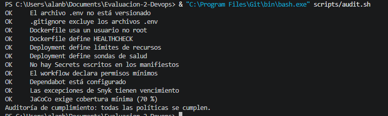

### Evidencias de los controles

| Job de cumplimiento | Escaneo de imagen (Trivy) |
|---|---|
| 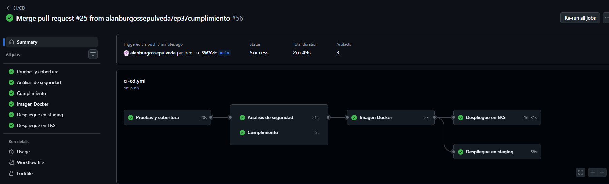 | 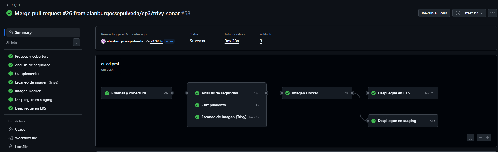 |

| Proyecto en SonarCloud | Job de calidad de código |
|---|---|
| 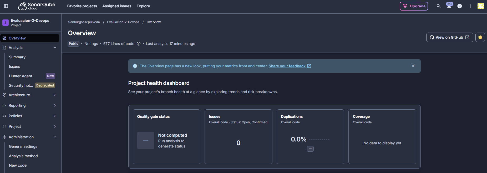 | 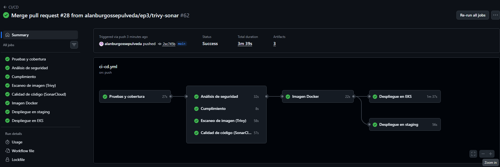 |

### Dos incidentes reales y cómo se resolvieron

**Falso positivo en Gitleaks.** El escáner marcó como "clave de API" la propiedad `sonar.projectKey`, que es un identificador público del proyecto. Se revisó el hallazgo, se confirmó que no era un secreto y se agregó una excepción **acotada** en `.gitleaks.toml` (solo para las propiedades `sonar.projectKey` y `sonar.organization`), sin desactivar el escáner.

**Versión de Java del analizador.** El *scanner* de SonarCloud exige Java 21 para ejecutarse, aunque el proyecto compile para Java 17. Se usa JDK 21 solo en el job `sonar`.

| Hallazgo de Gitleaks | Error de Java en Sonar |
|---|---|
| 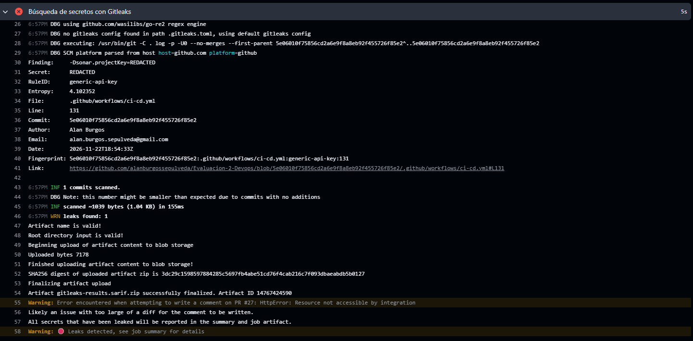 | 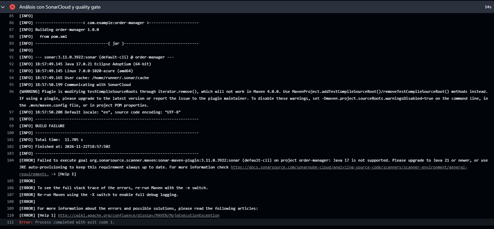 |

### Protección de la rama `main`

El ruleset exige Pull Request y los cinco controles. Antes de esta evaluación solo se exigían dos, y un Pull Request con los controles nuevos en rojo se pudo fusionar; al detectarlo se agregaron los tres restantes como obligatorios.

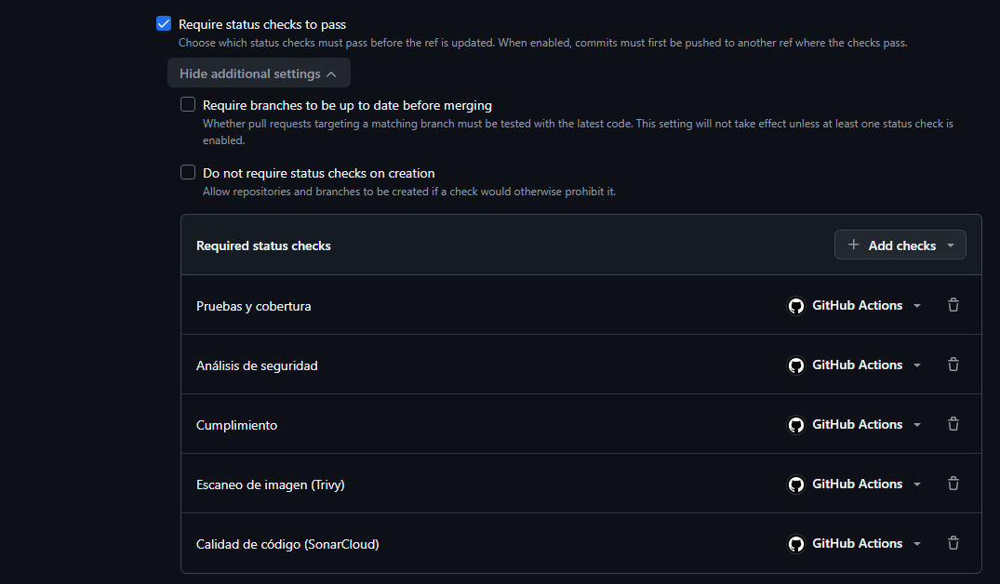

### Por qué estas políticas

- **JUnit + JaCoCo (≥ 70 %):** evita desplegar código roto o sin validar, reduciendo el riesgo de regresiones como se hace por buenas practicas
- **Snyk:** cubre el riesgo de introducir librerías de terceros con vulnerabilidades conocidas (altas o críticas).
- **Trivy:** protege contra fallos de seguridad a nivel de sistema operativo o capas base del contenedor antes de publicarlo.
- **Gitleaks:** evita filtrar credenciales, tokens o claves en el código fuente o en el historial de Git.
- **SonarCloud:** reduce deuda técnica, *code smells* y bugs estáticos que afectan la mantenibilidad y la seguridad.
- **`audit.sh`:** asegura buenas prácticas operativas (usuario no root, límites de recursos, sondas, exclusión de `.env`, permisos mínimos), mitigando fallos de configuración y escalada de privilegios.
- **Protección de rama `main`:** impide saltarse los controles mediante push directos, obligando a revisar y aprobar todos los checks antes de fusionar.

### Qué política agregaría con más tiempo

Firma de imágenes (Cosign) o verificación de manifiestos de Kubernetes (Checkov / Kyverno): para garantizar que solo se desplieguen imágenes firmadas por el pipeline y reforzar la validación automática de seguridad en los recursos del clúster.

---

## 14. Bloqueos automáticos demostrados (IE6)

Se probó que el pipeline **se detiene solo** ante fallos críticos. Cada demostración se hizo en una rama desechable con un Pull Request que **nunca se fusionó** (se cerró y se borró la rama), de modo que `main` no se vio afectada.

| Demostración | Qué se rompió | Control que detuvo el pipeline |
|---|---|---|
| Cobertura insuficiente (EP2) | Umbral de JaCoCo temporalmente en 95 % | Job de pruebas |
| Vulnerabilidad crítica (real) | `jackson-databind 3.1.7` | Snyk |
| Prueba que falla | Una aserción incorrecta a propósito | Job de pruebas |
| Secreto en el código | Una clave inventada en un archivo | Gitleaks |
| Política incumplida | Se quitó `USER app` del `Dockerfile` | Auditoría de políticas |

**Prueba que falla**

| Pull Request bloqueado | Log del job |
|---|---|
| 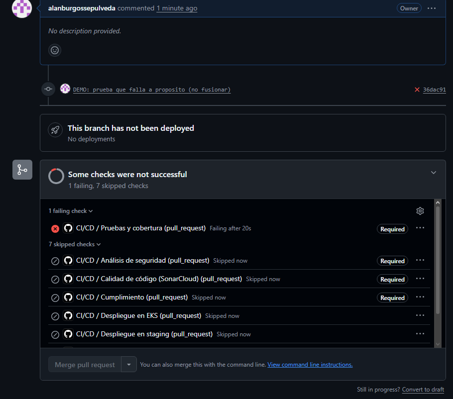 | 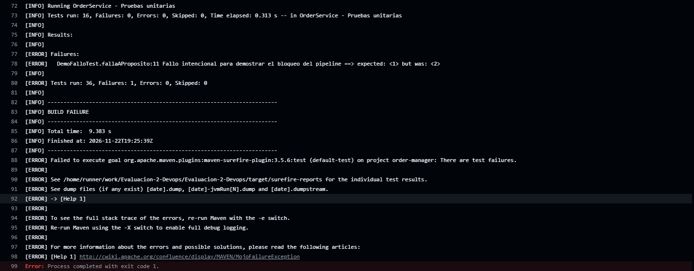 |

**Secreto en el código**

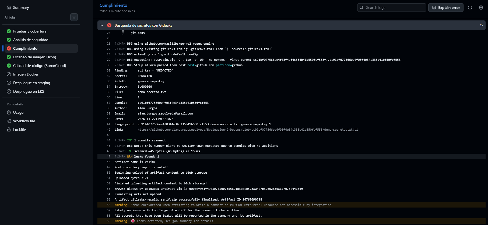

**Política incumplida**

| Pull Request bloqueado | Log de la auditoría |
|---|---|
|  |  |

**Casos previos** (evaluación anterior y vulnerabilidad real de esta): cobertura insuficiente y bloqueo por Snyk.

| Bloqueo por cobertura | Bloqueo por Snyk |
|---|---|
|  |  |

**Estado final de `main`:** todos los controles en verde y el despliegue completo.


---

## 15. Limitaciones conocidas

- **Datos de PostgreSQL en AWS no persistentes.** El clúster no tiene el controlador de discos EBS (requiere permisos de IAM que el laboratorio no permite), por lo que en AWS la base usa un volumen temporal: si el pod se reinicia, los datos se pierden. En un entorno real se usaría un volumen persistente.
- **Historial de métricas efímero.** Prometheus también usa un volumen temporal. Al reiniciarlo se pierde el historial, aunque las métricas del pipeline se recuperan porque el Pushgateway las conserva.
- **Credenciales temporales de AWS.** Las claves del laboratorio cambian en cada sesión, por lo que hay que renovarlas en los *secrets* del repositorio antes de cada despliegue.
- **Los nodos no sobreviven bien al reinicio del laboratorio.** Tras detener y reiniciar la sesión, los nodos dejaron de registrarse y hubo que recrearlos.
- **Logs centralizados solo en local.** Loki y Alloy se ejecutan en el entorno con Docker Compose; en el clúster se consultan con `kubectl logs`. Llevarlos al clúster es una mejora pendiente.
- **Grafana sin cifrado.** En el clúster se expone por HTTP en un balanceador público, con una clave simple. Es aceptable para un laboratorio que se destruye, pero no para producción.
- **Un solo ambiente real.** El clúster se eliminó al terminar para evitar costos; el repositorio conserva los manifiestos y el pipeline, que se reactivan poniendo `EKS_ENABLED=true` y recreando el clúster.
- **Actualizaciones de dependencias pendientes de revisión.** Dependabot mantiene abiertas propuestas de cambios mayores (por ejemplo, Spring Boot 4.1 o Java 25) que no se fusionaron por el riesgo que implican.

---

## 16. Cómo ejecutarlo

Requisitos: Git y Docker Desktop.

```bash
git clone https://github.com/alanburgossepulveda/Evaluacion-2-Devops.git
cd Evaluacion-2-Devops
```

Crear un archivo `.env` en la raíz (puedes partir de `.env.example`):

```
DB_NAME=orderdb
DB_USER=tu_usuario
DB_PASSWORD=tu_clave
GRAFANA_PASSWORD=otra_clave
```

**Aplicación y base de datos:**

```bash
docker compose up --build -d
```

Comprobar: `http://localhost:8098/actuator/health` responde `{"status":"UP"}`.

**Con monitoreo y logs** (Prometheus en `:9090`, Grafana en `:3000`, Loki en `:3100`):

```bash
docker compose -f docker-compose.yml -f docker-compose.monitoring.yml up -d
```

**Pruebas, sin instalar Java ni Maven** (PowerShell):

```powershell
docker run --rm -v "${PWD}:/app" -w /app maven:3.9-eclipse-temurin-17 mvn -B verify
```

**Auditoría de políticas** (Git Bash):

```bash
bash scripts/audit.sh
```

**Kubernetes** (en un clúster local o en EKS):

```bash
kubectl apply -f k8s/namespace.yaml
kubectl create secret generic db-credentials -n order-manager \
  --from-literal=DB_NAME=orderdb --from-literal=DB_USER=<usuario> --from-literal=DB_PASSWORD=<clave>
kubectl apply -f k8s/postgres.yaml     # en AWS: k8s/postgres-aws.yaml
kubectl apply -f k8s/app.yaml
```

---

## 17. Secretos y variables necesarios

*Settings → Secrets and variables → Actions*

| Nombre | Tipo | Uso |
|---|---|---|
| `SNYK_TOKEN` | Secret | Análisis de dependencias |
| `SONAR_TOKEN` | Secret | Análisis de SonarCloud |
| `DB_USER`, `DB_PASSWORD` | Secret | Despliegue en *staging* con Compose |
| `AWS_ACCESS_KEY_ID`, `AWS_SECRET_ACCESS_KEY`, `AWS_SESSION_TOKEN` | Secret | Acceso a EKS (temporales; se renuevan en cada sesión del laboratorio) |
| `EKS_ENABLED` | Variable | `true` activa el job de despliegue en EKS; `false` lo omite |

Dentro del clúster se crean a mano `db-credentials` (namespace `order-manager`) y `grafana-admin` (namespace `monitoring`). Ninguno está en el repositorio.

---

## 18. Declaración de uso de inteligencia artificial

Se utilizó únicamente **Claude** (Anthropic) como apoyo en la revisión de errores, la estructura del pipeline y de los manifiestos de Kubernetes, la redacción de comandos de apoyo y la estructura base de este documento (en la EP2 y en la EP3). El contenido generado fue revisado, ejecutado y validado por el autor.

Las justificaciones técnicas, el análisis de cómo las métricas apoyan decisiones, las conclusiones y la reflexión personal fueron escritas por el autor sin apoyo de IA.

Referencia (verificar el formato exacto en https://bibliotecas.duoc.cl/ia):

Anthropic. (2026). *Claude* [Modelo de lenguaje de gran tamaño]. https://claude.ai

---

## 19. Conclusiones

Integrar controles automáticos de calidad y seguridad en el pipeline junto con el despliegue en EKS y el monitoreo en Grafana permitió validar el código antes de publicarlo y observar su comportamiento real en ejecución, dejando como principales mejoras pendientes la persistencia de datos en AWS, la centralización de logs en el clúster y el cifrado de accesos.

<details>
<summary>Conclusiones de la entrega anterior (EP2)</summary>

Lo más valioso del pipeline fue meter Snyk y JaCoCo desde el inicio: frenar el código si no cumple con las pruebas o si trae vulnerabilidades ahorra muchos dolores de cabeza antes de publicar.

Si tuviera que cambiar algo hoy, sería el despliegue en staging. Levantar todo con Docker Compose dentro del mismo runner de GitHub sirve bien para validar que arranque, pero no se parece a un entorno real. A futuro, mejoraría esto integrando un clúster como Kubernetes para tener despliegues sin caídas de servicio (zero-downtime) y monitorear mejor la aplicación.

</details>

---

## 20. Reflexión personal

Al desarrollar de forma individual este flujo completo —desde endurecer controles en GitHub Actions hasta desplegar en EKS y observar el sistema con Prometheus, Loki y Grafana— aprendí a integrar seguridad, calidad y monitoreo continuo, superando restricciones reales del laboratorio como las credenciales temporales, la falta de volúmenes EBS y los ajustes de SonarCloud y Gitleaks mediante configuración controlada y pruebas iterativas.

<details>
<summary>Reflexión de la entrega anterior (EP2)</summary>

Con este trabajo entendí de verdad lo que significa asegurar y probar el código a medida que se desarrolla, no al final.

Lo que más me costó fue resolver las incompatibilidades al actualizar Spring Boot (adaptar pruebas a @MockitoBean) y lidiar con fallos externos durante la entrega, como errores de conexión con Snyk, lo que me obligó a revisar a fondo los logs para no quedarme bloqueado, además de averiguar acerca del error XML explicado en el reason. Este proyecto lo hice de manera individual, por lo que con ayuda de Claude pude resolver, me queda bastante por mejorar pero aun queda tiempo para estudiar.

</details>
