# Order Manager: pipeline CI/CD con GitHub Actions

Evaluación Parcial N°2, **DOY0101 Ingeniería DevOps**, sección 002.

**Autor:** Alan Maximiliano Burgos Sepúlveda (trabajo individual).

API REST para gestionar pedidos de un e-commerce. Este repositorio automatiza su ciclo de vida completo: pruebas, análisis de seguridad, construcción de la imagen Docker, publicación y despliegue en un entorno simulado.

---

## 1. El microservicio

| Elemento | Detalle |
|---|---|
| Lenguaje y framework | Java 17, Spring Boot 4.0.9, Maven |
| Persistencia | Spring Data JPA. H2 en memoria para desarrollo y pruebas, PostgreSQL 16 dentro de Docker |
| Monitoreo | Spring Boot Actuator (`/actuator/health`) |
| Puerto | 8098 |

Endpoints principales (`/api/orders`):

| Método | Ruta | Acción |
|---|---|---|
| GET | `/api/orders` | Listar pedidos |
| GET | `/api/orders/{id}` | Obtener un pedido |
| GET | `/api/orders/status/{status}` | Filtrar por estado |
| POST | `/api/orders` | Crear un pedido |
| POST | `/api/orders/{id}/items` | Agregar un ítem |
| PUT | `/api/orders/{id}/confirm`, `/ship`, `/deliver`, `/cancel` | Cambiar el estado |
| DELETE | `/api/orders/{id}` | Eliminar un pedido |

---

## 2. Arquitectura del pipeline

El pipeline vive en `.github/workflows/ci-cd.yml` y se ejecuta en cada `push` y en cada Pull Request hacia `main`.

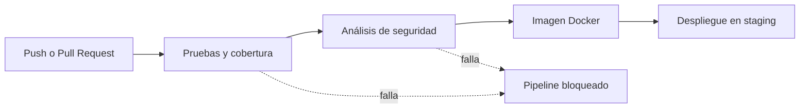

Cada job depende del anterior (`needs`). Si uno falla, los siguientes no se ejecutan.

| Job | Qué hace | Cuándo corre |
|---|---|---|
| **Pruebas y cobertura** | Ejecuta `mvn verify`: pruebas unitarias y de integración, y verifica el umbral de cobertura de JaCoCo. Guarda el reporte como artefacto | Siempre |
| **Análisis de seguridad** | Escanea las dependencias con Snyk. Falla ante vulnerabilidades de severidad alta o crítica | Siempre, si el job anterior pasó |
| **Imagen Docker** | Construye la imagen. La publica en GitHub Container Registry (GHCR) etiquetada con el SHA del commit | Siempre se construye; solo se publica en `push` |
| **Despliegue en staging** | Descarga la imagen publicada, la levanta con Docker Compose, espera el `health`, hace una prueba de humo y registra un resumen | Solo en `push` a `main` |

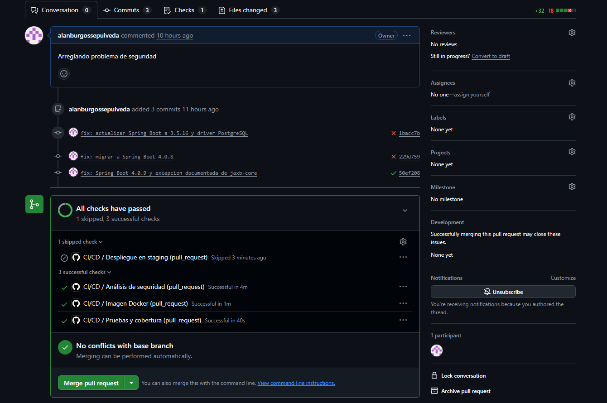

---

## 3. Contenedores (IE1)

El `Dockerfile` usa **dos etapas**:

1. **Compilación:** imagen `maven:3.9-eclipse-temurin-17`. Copia primero el `pom.xml` para aprovechar la caché de dependencias y luego el código.
2. **Ejecución:** imagen `eclipse-temurin:17-jre-alpine`, liviana y solo con el JRE y el `.jar`.

Configuraciones adicionales: la aplicación corre con un usuario **no root**, define un `HEALTHCHECK` sobre Actuator y el `.dockerignore` excluye `target/`, `.git/` y documentación.

---

## 4. Orquestación (IE5)

`docker-compose.yml` define dos servicios:

- **`db`** (PostgreSQL 16): con volumen persistente `db_data`, `healthcheck` con `pg_isready` y **sin puertos publicados** hacia el exterior.
- **`app`**: espera a que la base esté `healthy` (`depends_on` con `service_healthy`), usa el perfil `docker`, tiene límites de CPU (0,5) y memoria (512 MB) y reinicio automático.

Ambos comparten una red privada `backend`. Las credenciales llegan por variables de entorno (archivo `.env`, que no se versiona). El perfil `docker` (`application-docker.properties`) cambia la base a PostgreSQL, desactiva la consola H2 y oculta los detalles internos del `health`.

| Servicios levantados | Salud de la aplicación |
|---|---|
| 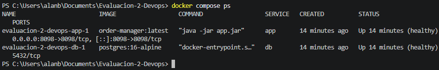 | 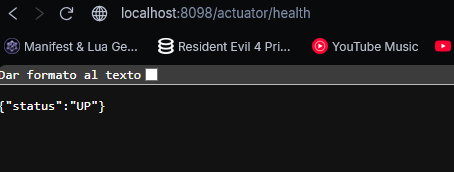 |

**Persistencia de datos:** se creó un pedido, se ejecutó `docker compose down` y `up -d`, y el pedido seguía disponible.

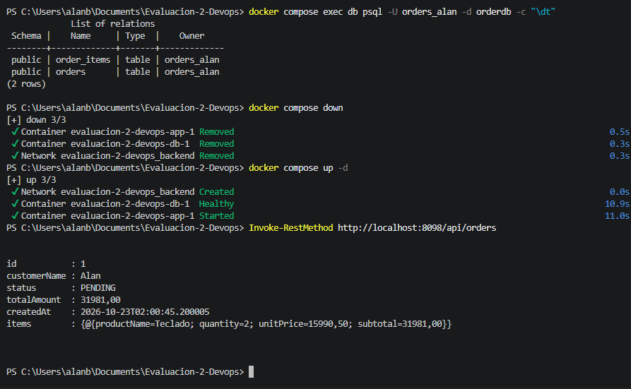

---

## 5. Calidad (IE2)

- **Pruebas:** 24 pruebas unitarias y de integración (JUnit 5, Mockito y MockMvc) sobre servicio y controlador.
- **Política de calidad:** cobertura mínima de **70 % de líneas**, verificada por JaCoCo en la fase `verify`. Si la cobertura baja de ese valor, `mvn verify` falla y el pipeline se detiene.
- **Evidencia del bloqueo:** se probó temporalmente con un umbral de 95 %, y el build falló como se esperaba. Luego se restauró el 70 %.

| Reporte de cobertura | Bloqueo por cobertura insuficiente |
|---|---|
| 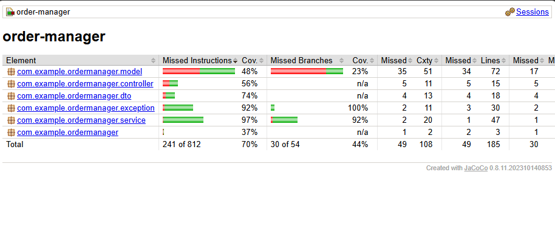 | 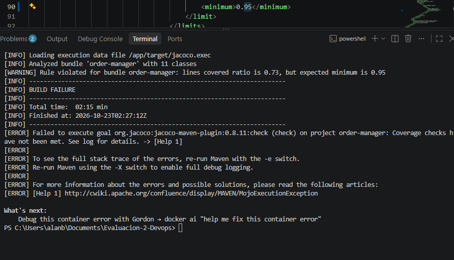 |

---

## 6. Seguridad y escalabilidad (IE3)

**Análisis de seguridad.** Snyk escanea las dependencias con `--severity-threshold=high`. Si encuentra vulnerabilidades altas o críticas, el job falla, el pipeline emite una anotación de error (`::error`) y no se construye ni se despliega nada.

**Historial real de las vulnerabilidades encontradas:**

| Versión | Problemas encontrados por Snyk |
|---|---|
| Spring Boot 3.3.4 | 69 |
| Spring Boot 3.5.16 | 25 |
| Spring Boot 4.0.8 | 13 |
| Spring Boot 4.0.9 y driver PostgreSQL 42.7.14 | Solo queda 1, sin corrección disponible (ver abajo) |

Se migró a Spring Boot 4.0.9, que corrige los problemas de Tomcat y Jackson. Esto implicó ajustes menores: el starter `spring-boot-starter-webmvc`, el starter de pruebas `spring-boot-starter-webmvc-test` y el reemplazo de `@MockBean` por `@MockitoBean` en el test del controlador.

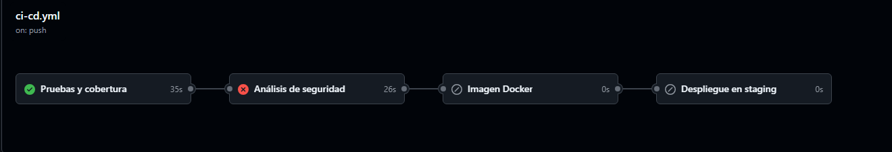

**Excepción documentada.** Queda una vulnerabilidad (`SNYK-JAVA-ORGGLASSFISHJAXB-20883142`, XXE en `jaxb-core`, que llega a través de Hibernate) para la cual Snyk indica que no existe actualización ni parche. Se registró en el archivo `.snyk` con vencimiento el 31 de diciembre de 2026, para obligar a revisarla. Justificación del equipo:

> Problema de XML External Entity (XXE) Injection, es una vulnerabilidad de alto riesgo que permite a un atacante interferir en cómo una aplicación procesa datos XML, lo que hace es agregar una línea DOCTYPE foo para acceder de manera remota, sin embargo, mi aplicación trabaja con JSON no con XML por lo que se acepta temporalmente el riesgo.

**Dependabot.** `.github/dependabot.yml` vigila semanalmente tres ecosistemas: Maven, Docker y GitHub Actions. Abre Pull Requests automáticos cuando hay versiones nuevas o vulnerabilidades.

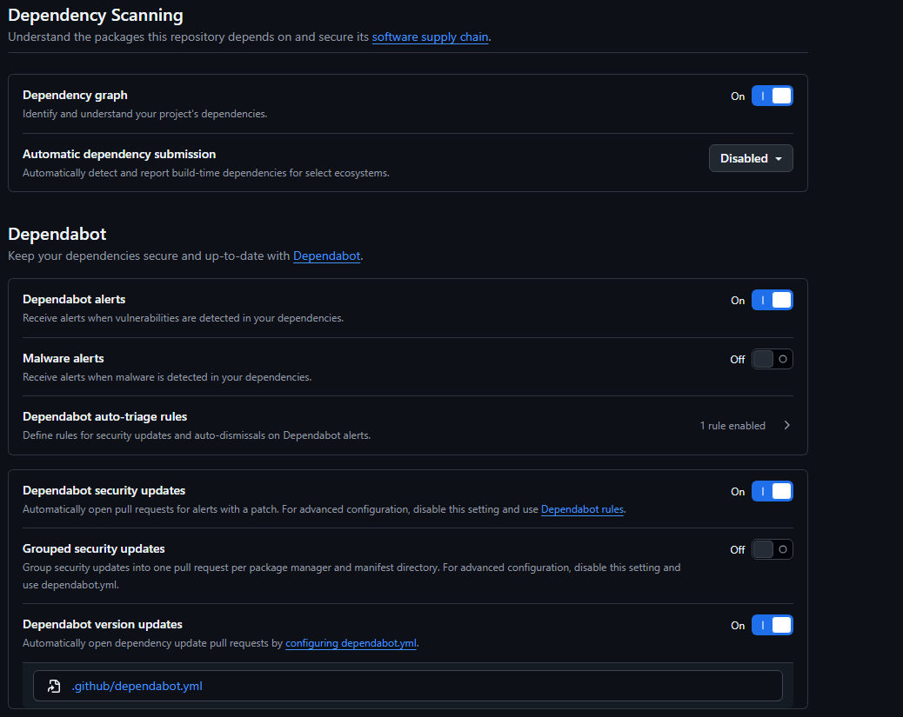

**Protección de la rama `main`.** Un ruleset exige Pull Request y que pasen los checks `Pruebas y cobertura` y `Análisis de seguridad` antes de fusionar. Así no puede entrar a `main` código que no cumpla la política de calidad y seguridad.

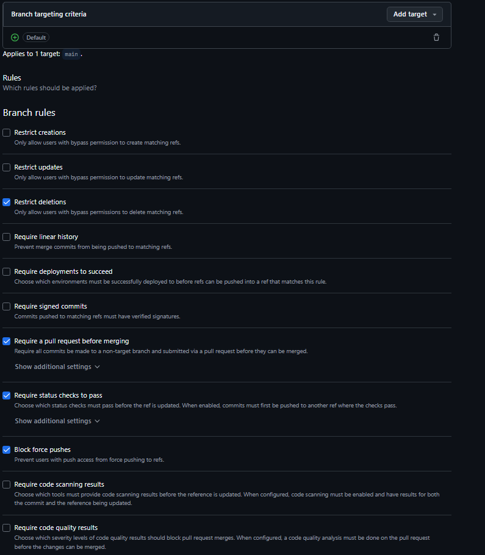

**Otras medidas:** credenciales en *secrets* de GitHub y nunca en el código, contenedor sin privilegios de root, base de datos sin puertos expuestos, límites de CPU y memoria, y reinicio automático de los servicios.

---

## 7. Trazabilidad (IE4)

Se puede seguir un cambio desde el desarrollo hasta el despliegue:

1. **Commit y Pull Request:** cada cambio queda registrado en el historial, con su rama y revisión.
2. **Ejecución del pipeline:** GitHub Actions asocia cada ejecución a un commit concreto.
3. **Imagen:** se publica en GHCR etiquetada con el **SHA completo del commit**, de modo que cada imagen se vincula con el código exacto que la generó.
4. **Despliegue:** el job usa esa misma imagen, la registra en el *Environment* `staging` y deja un resumen con commit, autor, imagen y número de ejecución.

| Imagen publicada | Entorno staging |
|---|---|
| 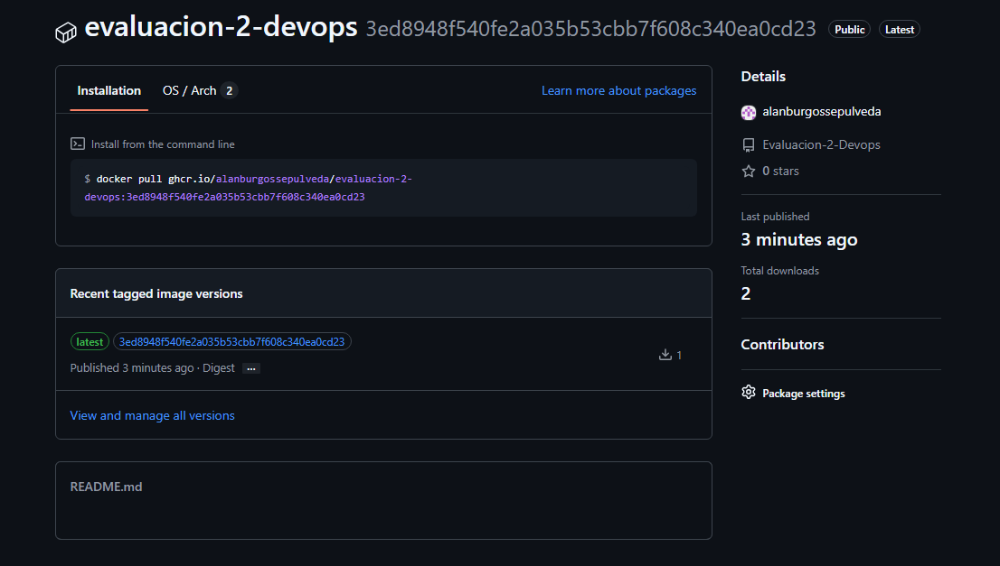 | 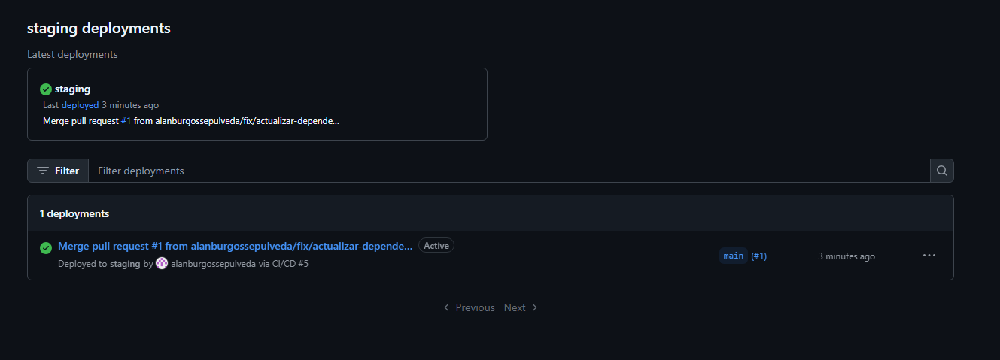 |

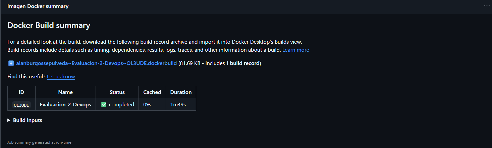

---

## 8. Cómo ejecutarlo en local

Requisitos: Git y Docker Desktop.

```bash
git clone https://github.com/alanburgossepulveda/Evaluacion-2-Devops.git
cd Evaluacion-2-Devops
```

Crear un archivo `.env` en la raíz (puedes partir de `.env.example`):

```
DB_NAME=orderdb
DB_USER=tu_usuario
DB_PASSWORD=tu_clave
```

Levantar todo:

```bash
docker compose up --build -d
docker compose ps
```

Comprobar: `http://localhost:8098/actuator/health` debe responder `{"status":"UP"}`.

Ejecutar las pruebas sin instalar Java ni Maven (PowerShell):

```powershell
docker run --rm -v "${PWD}:/app" -w /app maven:3.9-eclipse-temurin-17 mvn -B verify
```

---

## 9. Secrets necesarios en GitHub

*Settings → Secrets and variables → Actions → Repository secrets*:

| Nombre | Uso |
|---|---|
| `SNYK_TOKEN` | Autenticación del análisis de seguridad |
| `DB_USER` | Usuario de PostgreSQL en el despliegue |
| `DB_PASSWORD` | Contraseña de PostgreSQL en el despliegue |

Además, en *Settings → Actions → General → Workflow permissions* debe estar activo **Read and write permissions** para poder publicar la imagen.

---

## 10. Declaración de uso de inteligencia artificial

Se utilizó únicamente **Claude** (Anthropic), como apoyo en la revisión de errores y en la estructura del pipeline. También se apoyó la estructura base de este documento. El contenido generado fue revisado y validado por el autor. Las justificaciones técnicas, las conclusiones y la reflexión personal fueron escritas sin apoyo de IA.

Referencia (verificar el formato exacto en https://bibliotecas.duoc.cl/ia):

Anthropic. (2026). *Claude* [Modelo de lenguaje de gran tamaño]. https://claude.ai

---

## 11. Conclusiones

Lo más valioso del pipeline fue meter Snyk y JaCoCo desde el inicio: frenar el código si no cumple con las pruebas o si trae vulnerabilidades ahorra muchos dolores de cabeza antes de publicar.

Si tuviera que cambiar algo hoy, sería el despliegue en staging. Levantar todo con Docker Compose dentro del mismo runner de GitHub sirve bien para validar que arranque, pero no se parece a un entorno real. A futuro, mejoraría esto integrando un clúster como Kubernetes para tener despliegues sin caídas de servicio (zero-downtime) y monitorear mejor la aplicación.

## 12. Reflexión personal

Con este trabajo entendí de verdad lo que significa asegurar y probar el código a medida que se desarrolla, no al final.

Lo que más me costó fue resolver las incompatibilidades al actualizar Spring Boot (adaptar pruebas a @MockitoBean) y lidiar con fallos externos durante la entrega, como errores de conexión con Snyk, lo que me obligó a revisar a fondo los logs para no quedarme bloqueado, además de averiguar acerca del error XML explicado en el reason. Este proyecto lo hice de manera individual, por lo que con ayuda de Claude pude resolver, me queda bastante por mejorar pero aun queda tiempo para estudiar.
